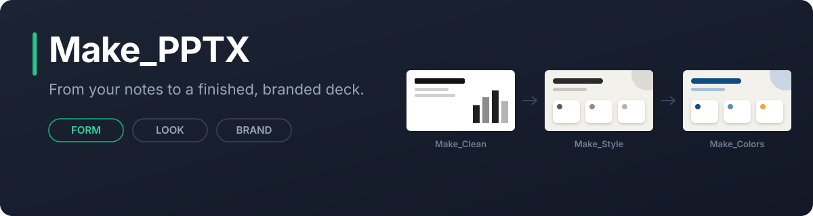

<div align="center">

[](https://github.com/MaximeRumpler/Make_PPTX)

*Give your AI assistant your notes. Get back a finished PowerPoint deck, in your style and your brand colours when you need them.*

[](LICENSE)
[](#the-make-pptx-set)
[](https://maximerumpler.github.io/Make_Clean_PPTX/)

</div>

* * *

## What it is

Make PPTX is a set of three *skills*. A skill is a folder of instructions and small tools that an AI assistant such as Claude or Codex loads when you ask for a presentation. You give it your notes; you get back a PowerPoint deck built from tested slide designs and checked before delivery.

Each skill does one job, and you only use the ones you need:

```text
your notes  →  Make_Clean  →  Make_Style  →  Make_Colors  →  your deck
               form           look           brand
```

* * *

## The Make PPTX set

| **Make_Clean_PPTX** | **Make_Style_PPTX** | **Make_Colors_PPTX** |
|:---|:---|:---|
| **Form.** Notes in, a clean deck out: one message per slide, tested layouts and charts. | **Look.** The same deck in another style: other shapes, arrangements and backgrounds. | **Brand.** Your colours, fonts and logo, from your brand guidelines, website or example files. |
| [Install](https://github.com/MaximeRumpler/Make_Clean_PPTX#install) · [Gallery](https://maximerumpler.github.io/Make_Clean_PPTX/) | In preparation | In preparation |

*Start with Make_Clean_PPTX for the structure. Add a style and your brand colours when you need them.*

**Available today: Make_Clean_PPTX.** 54 slide layouts, 81 charts and diagrams (19 of them opt-in), 1,900 icons. Black, grey and white, or your company's PowerPoint theme and logo. The other two build on it.

* * *

## Get started

Make_Clean_PPTX installs in a few steps in Claude.ai, Claude desktop, Claude Code, Codex, Cursor, GitHub Copilot, Gemini CLI and other AI assistants, on Windows, macOS and Linux. In Claude.ai and Claude desktop, also turn on *Code execution and file creation*. In Claude Code, the set has one marketplace:

```text
/plugin marketplace add MaximeRumpler/Make_PPTX
/plugin install make-clean-pptx@make-pptx
```

**[Get started](docs/get-started.md)**: install for your assistant, check that it works, what to give it, the quick choices it asks about, and answers to common problems. For the best first deck, fill in the [brief template](docs/brief-template.md).

Something did not work? [Open an issue](https://github.com/MaximeRumpler/Make_Clean_PPTX/issues/new/choose) with the *It didn't work* form: no technical knowledge needed.

Then just ask, in your own words, and paste or attach your content:

```text
Make a 10-slide deck from this report for the board.
Make an 8-slide deck in French from these notes.
Make a 12-slide pitch deck from these notes: problem, solution, market, traction, team, ask.
Make a project review deck from this status report: progress, risks, next steps.
Make a workshop deck from this agenda, one slide per exercise.
Turn this table of figures into 6 slides with charts.
Review my-deck.pptx and make it look professional. Keep my content.
Make a 5-slide summary of this document as a LibreOffice .odp file, with speaker notes.
```

* * *

## Principles

| **Your content stays yours** | **Tested slides, checked output** | **Plain requests** |
|:---|:---|:---|
| No invented figures, quotes or names. You own the decks you make. | Slides come from tested libraries, then are checked for overflow, density and readability. | Ask in English or French, in your own words. A short install, and a plain message when something is missing. |

* * *

## Licence

[EUPL-1.2](LICENSE), the open source licence of the European Union: free to use; if you share an improved version, share it under the same licence. **You own the decks you make.** The EUPL does not apply to them and no attribution is required ([NOTICE](NOTICE)).

<div align="center">

Built by [**Maxime Rumpler**](https://github.com/MaximeRumpler) · [](https://github.com/KairosTech-fr) · [kairostech.fr](https://kairostech.fr)

<sub>With thanks to the creators and contributors of [impeccable](https://github.com/pbakaus/impeccable), whose design skills for AI agents inspired this set, and of Wikipedia's [Signs of AI writing](https://en.wikipedia.org/wiki/Wikipedia:Signs_of_AI_writing), which guides how its texts are written.</sub>

<p align="right">
  
</p>

</div>
